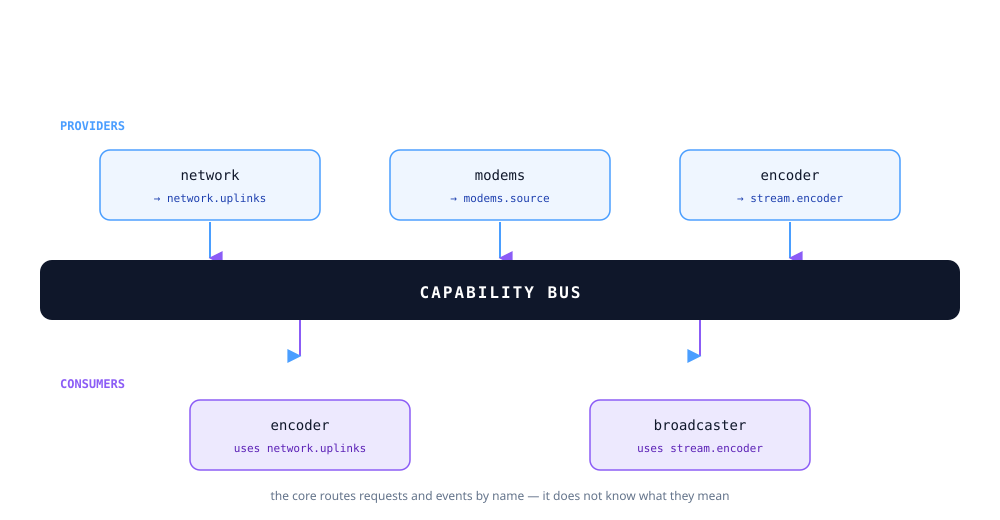

# Ctrl-IRL


<div style="float: left; margin-right: 20px;">

</div>

Bun-based controller for streaming. One module-driven device client runs the selected role, and an optional control server manages a fleet from a browser.
Every capability is a **self-contained module** that talks to the rest of the system only over a **capability bus**. A device client runs exactly one **role** (a declarative set of modules and capabilities), while an optional **control server** manages a fleet from the browser. The same module system powers both sides: device modules run on the box, server modules power dashboards and overlays.

[](https://github.com/majklovec/ctrlirl/actions)
[](https://github.com/majklovec/ctrlirl/releases)
[](https://bun.sh)
[](https://www.typescriptlang.org)
<br clear="all"/>

## Architecture at a glance


-   **Device client** (`client/`) — runs on the streaming box. Picks a role and starts the modules that role declares.
-   **Control server** (`server/`) — optional. Aggregates telemetry from devices, serves the dashboard, and exposes overlays for OBS.
-   **Modules** — the unit of functionality. Each module is a directory with a backend (Bun, no DOM) and an optional frontend (device-page card, dashboard widget, overlay element).
-   **Capability bus** — the only way modules talk to each other. Modules **provide** named capabilities and **consume** them by name; the core routes requests and events without knowing what they mean.
-   **Roles** — declarative sets of modules. A role contains no logic itself; it just names which modules to start.

## Roles


A role is a directory under `client/roles/<role>/` with a `role.ts` that lists the modules to load. The device client runs exactly one role at a time, chosen with `--role`.

| Role              | What it does                                             | Key modules                           | Capabilities it provides / consumes                                  |
| ----------------- | -------------------------------------------------------- | ------------------------------------- | -------------------------------------------------------------------- | --- |
| `relay` (default) | SRTLA→SRTLA bridge; uplink and ModemManager handling     | `relay`, `network`, `modems`, `ssh`   | provides `stream.relay`; consumes `network.uplinks`, `modems.source` |
| `encoder`         | Runs belacoder/ceracoder and its local `srtla_send`      | `encoder`, `network`, `modems`, `obs` | consumes `network.uplinks`, `modems.source`                          |
| `obs`             | Connects to OBS Studio and exposes a scene switcher      | `obs`                                 | provides `obs.events`                                                |
| `broadcaster`     | SRTLA ingress + RTMP output via ffmpeg                   | `broadcaster`                         | provides `broadcast.outputs`                                         |
| `ctrlink_relay`   | Transparent L2 bridging of LAN interfaces to the encoder | `ctrlink_relay`                       | provides `ctrlink.lan` (per-interface GRETAP tunnels)                |     |

<!-- IMAGE: device dashboard / role picker — e.g.  -->

Capability names in the last column are illustrative. The source of truth is the registration in each module's `backend.ts`.

## Modules

Modules are the unit of functionality. Each lives in its own directory and exposes:

-   `backend.ts` — Bun-side code (no DOM). Registers capabilities, event handlers, and lifecycle hooks.
-   `frontend.tsx` — optional. Device-page card, dashboard widget, or overlay element.
-   module-local types, styles, and i18n.

A module **never names a role**. It only knows the capabilities it provides and the capabilities it consumes. The role wires them together.

### Device modules

These run on the box, under `client/modules/`.

| Module             | Description                                                                                                                                          |
| ------------------ | ---------------------------------------------------------------------------------------------------------------------------------------------------- |
| `encoder`          | Starts and supervises the encoder process (`belacoder`/`ceracoder`) and its local `srtla_send`. Pipeline discovery, automatic restart, live bitrate. |
| `relay`            | Owns the SRTLA→SRTLA bridge: `srtla_rec` + `srtla_send`, uplink management, reload on bonding changes.                                               |
| `network`          | Interface discovery, SRTLA bonding (policy routing, `ip monitor`). Provides `network.uplinks`.                                                       |
| `modems`           | ModemManager (`mmcli`) integration — modem state, enable/disable/reset/connect actions. Provides `modems.source`.                                    |
| `obs`              | Native obs-websocket v5 connection; forwards events into the device event stream.                                                                    |
| `broadcaster`      | SRTLA ingress + RTMP publishing via ffmpeg.                                                                                                          |
| `ssh`              | sshd management and SSH account password handling.                                                                                                   |
| `ctrlink_relay`    | Creates GRETAP tunnels on the relay box and bridges its LAN interfaces into them, for transparent L2 bridging (see **Ctrlink** below).               |
| `ctrlink_streamer` | Creates the matching GRETAP interfaces on the encoder and bridges them, so the relay's LAN segments appear as local Ethernet.                        |

### Server modules

These run inside the control server / dashboard, under `server/pages/<slice>/modules/`, and are loaded only when their slice is active.

| Module             | Description                                                   |
| ------------------ | ------------------------------------------------------------- |
| `stats`            | Channel stat widgets.                                         |
| `chat`             | Chat widget + OBS overlay element.                            |
| `deck`             | Fleet dashboard widget — a virtual StreamDeck across devices. |
| `overlay_elements` | Built-in OBS overlay elements (plugins only, no backend).     |

### Capability bus



Modules communicate **only over the capability bus** — never by direct import.

-   A **capability** is a named contract (e.g. `network.uplinks`, `modems.source`, `stream.relay`).
-   A module **provides** a capability by registering it in its backend registration.
-   Another module **consumes** it by asking the bus for that name.
-   The core knows nothing about individual capabilities — it only routes requests and events by name.

This is what makes modules replaceable and roles declarative: swapping an implementation is a matter of providing the same capability name under a different module.

## Ctrlink — transparent L2 bridging


Ctrlink lets you carry Ethernet traffic from the relay box to the encoder **without configuring routing on the relay**. It is built on **GRETAP** (Ethernet over GRE) tunnels and consists of two cooperating modules:

-   **`ctrlink_relay`** (on the relay box) — creates one GRETAP interface per shared LAN segment and bridges the corresponding LAN interface into it. Ethernet frames are encapsulated over GRE and sent to the encoder.
-   **`ctrlink_streamer`** (on the encoder) — creates the matching GRETAP interfaces and bridges them locally. The encoder sees the relay's LAN segments as local Ethernet interfaces, with the same MAC addresses and broadcast domain.

Because this is L2, the relay does not need to know which IPs the encoder wants to reach — it just bridges frames. The SRTLA destination stays on the encoder; the relay only transparently forwards traffic. This is useful when the encoder needs to reach devices on the relay's LAN (cameras, sensors, …) without a complex routing setup.

GRETAP is configured over the same transport that carries SRTLA, so no additional ports need to be opened between the two boxes beyond what SRTLA already uses.

## Requirements

-   [Bun](https://bun.sh) — runtime for both the device client and the control server
-   Linux with `iproute2` and `iptables`/`nftables` for bonding and policy routing
-   `ModemManager` (`mmcli`) for the `modems` module
-   `belacoder`/`ceracoder` and `srtla_send`/`srtla_rec` for the streaming modules
-   `ffmpeg` for the `broadcaster` module
-   `sshd` for the `ssh` module

Modules check for their own dependencies at startup and log what is missing.

## Getting started

### Device client

Run a role directly:

```sh
sudo bun client/backend/client.ts --role relay
```
