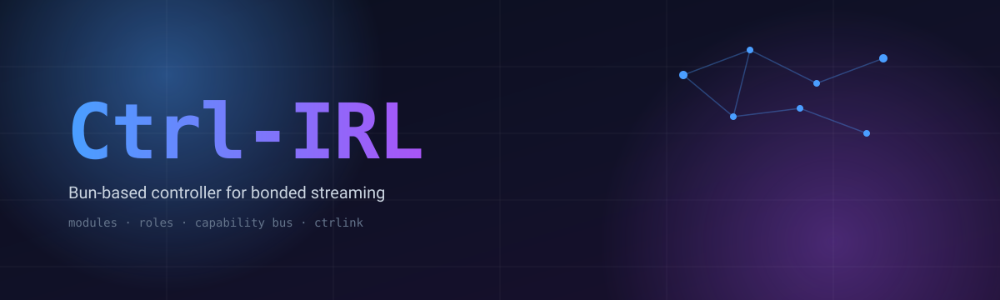
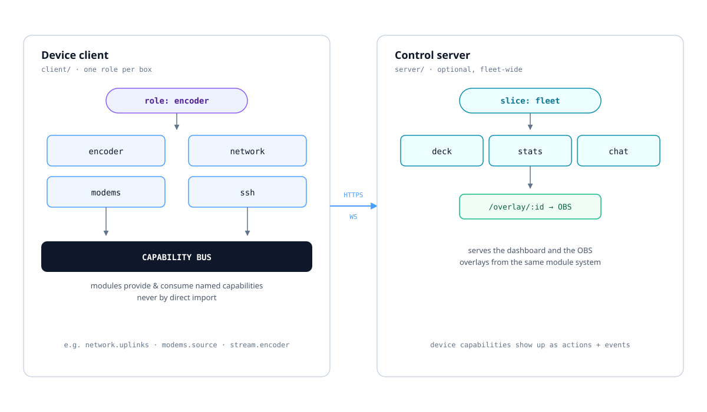
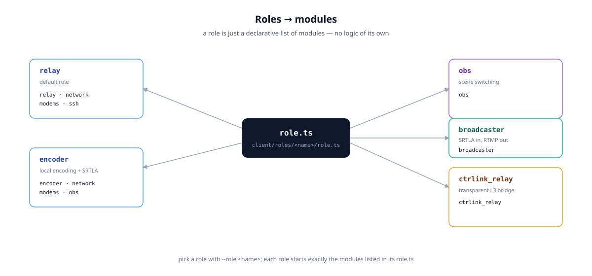
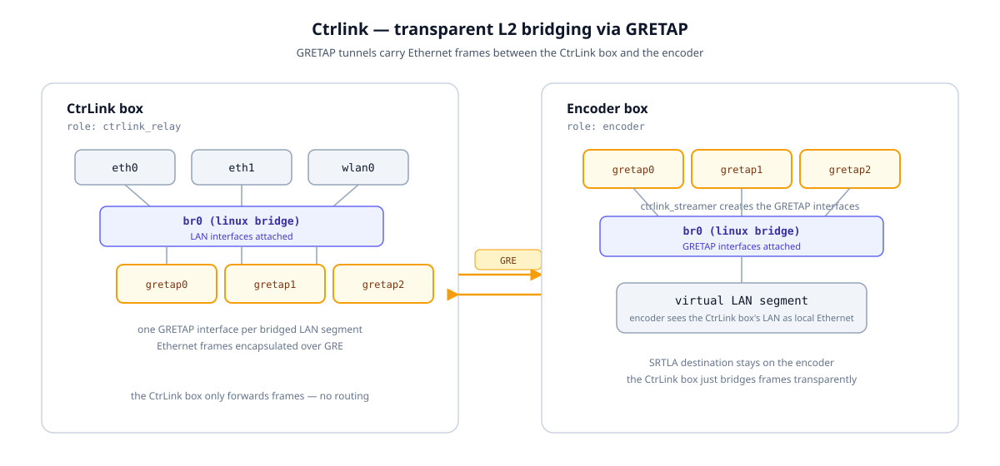

# Ctrl-IRL



<div style="float: left; margin-right: 20px;">

</div>

Bun-based controller for streaming. One module-driven device client runs the selected role, and an optional control server manages a fleet from a browser.
Every capability is a **self-contained module** that talks to the rest of the system only over a **capability bus**. A device client runs exactly one **role** (a declarative set of modules and capabilities), while an optional **control server** manages a fleet from the browser. The same module system powers both sides: device modules run on the box, server modules power dashboards and overlays.

[](https://github.com/majklovec/ctrlirl/actions)
[](https://github.com/majklovec/ctrlirl/releases)
[](https://bun.sh)
[](https://www.typescriptlang.org)
<br clear="all"/>

## Architecture at a glance



-   **Device client** (`client/`) — runs on the streaming box. Picks a role and starts the modules that role declares.
-   **Control server** (`server/`) — optional. Aggregates telemetry from devices, serves the dashboard, and exposes overlays for OBS.
-   **Modules** — the unit of functionality. Each module is a directory with a backend (Bun, no DOM) and an optional frontend (device-page card, dashboard widget, overlay element).
-   **Capability bus** — the only way modules talk to each other. Modules **provide** named capabilities and **consume** them by name; the core routes requests and events without knowing what they mean.
-   **Roles** — declarative sets of modules. A role contains no logic itself; it just names which modules to start.

## Roles



A role is a directory under `client/roles/<role>/` with a `role.json` that lists the modules to load. The device client runs exactly one role at a time, chosen with `--role`.

| Role              | What it does                                             | Key modules                           | Capabilities it provides / consumes                                  |
| ----------------- | -------------------------------------------------------- | ------------------------------------- | -------------------------------------------------------------------- |
| `encoder` (default) | Runs belacoder/ceracoder and its local `srtla_send`    | `encoder`, `network`, `srtla`, `modems`, `obs` | provides `stream.encoder`; consumes `network.uplinks`, `modems.source` |
| `obs`             | Connects to OBS Studio and exposes a scene switcher      | `obs`                                 | provides `obs.events`                                                |
| `broadcaster`     | SRTLA ingress + RTMP output via ffmpeg                   | `broadcaster`                         | provides `broadcast.outputs`                                         |
| `ctrlink_relay`   | Extends the relay's LAN uplinks to the encoder over WireGuard     | `ctrlink_relay`                       | provides `ctrlink.lan` (per-uplink WireGuard tunnels)                |

<!-- IMAGE: device dashboard / role picker — e.g.  -->

Capability names in the last column are illustrative. The source of truth is the registration in each module's `backend.ts`.

## Modules

Modules are the unit of functionality. Each lives in its own directory and exposes:

-   `backend.ts` — Bun-side code (no DOM). Registers capabilities, event handlers, and lifecycle hooks.
-   `frontend.tsx` — optional. Device-page card, dashboard widget, or overlay element.
-   module-local types, styles, and i18n.

A module **never names a role**. It only knows the capabilities it provides and the capabilities it consumes. The role wires them together.

### Device modules

These run on the box, under `client/modules/`.

| Module             | Description                                                                                                                                          |
| ------------------ | ---------------------------------------------------------------------------------------------------------------------------------------------------- |
| `encoder`          | Starts and supervises the encoder process (`belacoder`/`ceracoder`) and its local `srtla_send`. Pipeline discovery, automatic restart, live bitrate. |
| `network`          | Interface discovery, bond selection and the live `ip monitor`. Provides `network.interfaces` (detection + the bond + reconcile hooks).                 |
| `srtla`            | The SRTLA leg's source routing (per-uplink `ip rule`/`ip route` tables), the `srtla_send` uplinks file and the default-route failover. Encoder-only. Provides `network.uplinks`. |
| `modems`           | ModemManager (`mmcli`) integration — modem state, enable/disable/reset/connect actions. Provides `modems.source`.                                    |
| `obs`              | Native obs-websocket v5 connection; forwards events into the device event stream.                                                                    |
| `broadcaster`      | SRTLA ingress + RTMP publishing via ffmpeg.                                                                                                          |
| `ssh`              | sshd management and SSH account password handling.                                                                                                   |
| `ctrlink_relay`    | Creates one plain-UDP↔TUN leg per uplink on the relay box (leg TUN `rtltun_<if>`, see **Ctrlink** below).                                                    |
| `ctrlink_streamer` | Creates the matching `rltun<R>_<if>` TUN virtual interfaces on the encoder, so each relay uplink provides full Internet egress.                             |

### Server modules

These run inside the control server / dashboard, under `server/pages/<slice>/modules/`, and are loaded only when their slice is active.

| Module             | Description                                                   |
| ------------------ | ------------------------------------------------------------- |
| `stats`            | Channel stat widgets.                                         |
| `chat`             | Chat widget + OBS overlay element.                            |
| `deck`             | Fleet dashboard widget — a virtual StreamDeck across devices. |
| `overlay_elements` | Built-in OBS overlay elements (plugins only, no backend).     |

### Capability bus


Modules communicate **only over the capability bus** — never by direct import.

-   A **capability** is a named contract (e.g. `network.uplinks`, `modems.source`, `stream.encoder`).
-   A module **provides** a capability by registering it in its backend registration.
-   Another module **consumes** it by asking the bus for that name.
-   The core knows nothing about individual capabilities — it only routes requests and events by name.

This is what makes modules replaceable and roles declarative: swapping an implementation is a matter of providing the same capability name under a different module.

## Ctrlink — uplink transport



Ctrlink extends the CtrLink box's LAN uplinks to the encoder so the encoder can reach the Internet (or other destinations) through them. It is a **plain-UDP↔TUN** transport and consists of two cooperating modules:

-   **`ctrlink_relay`** (on the CtrLink box) — creates one leg TUN `rtltun_<uplink>` per uplink, each paired with a UDP socket, an egress policy route and NAT.
-   **`ctrlink_streamer`** (on the encoder) — creates the matching `rltun<R>_<if>` TUN virtual interfaces. Each becomes a routable uplink the encoder can use for full Internet egress through that relay uplink.

Because this is L3 (routed, not bridged), each leg gets its own per-slot addressing and the encoder routes traffic per uplink, so a vif is a first-class uplink for SRTLA as well. This is useful when the encoder needs a reliable Internet (or site) path through the CtrLink box's uplinks — for example as a cellular fallback.

The tunnels are negotiated over the same control channel that carries SRTLA discovery, so no additional ports need to be opened between the two boxes beyond what SRTLA already uses.

## Requirements

-   [Bun](https://bun.sh) — runtime for both the device client and the control server
-   Linux with `iproute2` and `iptables`/`nftables` for bonding and policy routing
-   `ModemManager` (`mmcli`) for the `modems` module
-   `belacoder`/`ceracoder` and `srtla_send`/`srtla_rec` for the streaming modules
-   `ffmpeg` for the `broadcaster` module
-   `sshd` for the `ssh` module

Modules check for their own dependencies at startup and log what is missing.

## Getting started

### Install via apt (Linux)

The device client is published as the `ctrlirl-coder` deb package from the project's [signed apt repository](https://majklovec.github.io/ctrlirl/). Add the repo and install:

```sh
sudo mkdir -p /etc/apt/keyrings
curl -fsSL https://majklovec.github.io/ctrlirl/deb/ctrlirl.asc -o /etc/apt/keyrings/ctrlirl.asc
echo "deb [signed-by=/etc/apt/keyrings/ctrlirl.asc] https://majklovec.github.io/ctrlirl/deb ctrlirl main" | sudo tee /etc/apt/sources.list.d/ctrlirl-coder.list
sudo apt-get update
sudo apt-get install ctrlirl-coder
```

The package installs the client to `/opt/ctrlirl`; run a role with `/opt/ctrlirl/ctrlirl --host 0.0.0.0 <role>`. `sudo apt-get upgrade ctrlirl-coder` picks up the newest release once it is published.

### Device client

Run a role directly:

```sh
sudo bun client/backend/client.ts --role encoder
```
